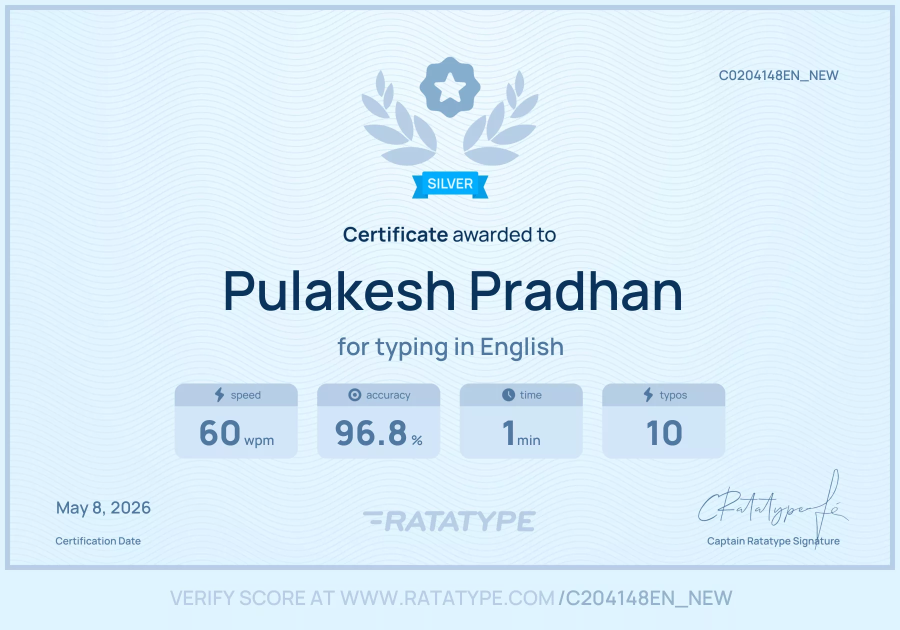

::: {.profile-column}
::: {.profile-card}

# Pulakesh Pradhan
### PhD Scholar in Geography (Thesis Submitted) | MPhil, UGC-SRF

::: {.profile-tagline}
A task will take as long as the time you give it.
:::

::: {.social-links}
[<i class="bi bi-linkedin"></i> LinkedIn](https://www.linkedin.com/in/pulakeshpradhan/){.social-btn}
[<i class="bi bi-mortarboard"></i> Scholar](https://scholar.google.com/citations?user=_DhEQHEAAAAJ){.social-btn}
[<i class="bi bi-youtube"></i> YouTube](https://www.youtube.com/@SpatialGeography){.social-btn}
[<i class="bi bi-envelope"></i> Email](mailto:pulakesh.mid@gmail.com){.social-btn}
:::

:::
:::

## 📅 Recent Events
::: {#past-events}
:::
[<i class="bi bi-arrow-right-circle"></i> View all events](events.qmd){.social-btn .section-link}

## 📌 Latest Insights
::: {#latest-posts}
:::
[<i class="bi bi-arrow-right-circle"></i> View all posts](blog.qmd){.social-btn .section-link}

## 👥 Social Updates

::: {.social-card}
::: {}
### GEE AI Assistant: 4k+ Global Users!
**Google Earth Engine Coding Companion**

I am thrilled to announce that the **GEE AI Assistant** now has over **4,000+ worldwide users** from **134 countries**. Thank you for your trust and support in building this Gemini-powered geospatial community!

::: {.pill-row}
[<i class="bi bi-browser-chrome"></i> Install from Chrome Web Store](https://chromewebstore.google.com/detail/kldhacnbicjpbdiebjjflnhgcmheokkl?utm_source=item-share-cb){.pill-btn .pill-solid}
:::
:::
::: {}
[{.nolightbox fig-alt="GEE AI Assistant user statistics"}](https://chromewebstore.google.com/detail/kldhacnbicjpbdiebjjflnhgcmheokkl?utm_source=item-share-cb)
:::
:::

[<i class="bi bi-arrow-right-circle"></i> View all updates](social.qmd){.social-btn .section-link}

## 🤝 Groups I Manage

::: {.groups-grid}
<a href="https://www.facebook.com/groups/762174011717920" target="_blank" class="group-card group-card-facebook">

<svg xmlns="http://www.w3.org/2000/svg" fill="currentColor" viewBox="0 0 16 16">
<path d="M16 8.049c0-4.446-3.582-8.05-8-8.05C3.58 0 0 3.603 0 8.05 0 12.07 2.928 15.43 6.75 16v-5.625h-2.03v-2.326h2.03V6.272c0-2.006 1.194-3.114 3.022-3.114.876 0 1.791.157 1.791.157v1.97h-1.009c-.993 0-1.303.621-1.303 1.258v1.506h2.218l-.354 2.326H9.25V16c3.822-.57 6.75-3.93 6.75-7.951z"/>
</svg>

Facebook Group

Geography- Conference, Webinar & Publication

<i class="bi bi-people-fill"></i> 2.6k+ Members

Join Group <i class="bi bi-arrow-right"></i>

</a>
<a href="https://www.linkedin.com/groups/14152423/" target="_blank" class="group-card group-card-linkedin">

<svg xmlns="http://www.w3.org/2000/svg" fill="currentColor" viewBox="0 0 16 16">
<path d="M0 1.146C0 .513.526 0 1.175 0h13.65C15.474 0 16 .513 16 1.146v13.708c0 .633-.526 1.146-1.175 1.146H1.175C.526 16 0 15.487 0 14.854V1.146zm4.943 12.248V6.169H2.542v7.225h2.401zm-1.2-8.212c.837 0 1.358-.554 1.358-1.248-.015-.709-.52-1.248-1.342-1.248-.822 0-1.359.54-1.359 1.248 0 .694.521 1.248 1.327 1.248h.016zm4.908 8.212V9.359c0-.216.016-.432.08-.586.173-.431.568-.878 1.232-.878.869 0 1.216.662 1.216 1.634v3.865h2.401V9.25c0-2.22-1.184-3.252-2.764-3.252-1.274 0-1.845.7-2.165 1.193v.025h-.016a5.54 5.54 0 0 1 .016-.025V6.169h-2.4c.03.678 0 7.225 0 7.225h2.4z"/>
</svg>

LinkedIn Group

Geography & Google Earth Engine

<i class="bi bi-people-fill"></i> 180+ Members

Join Group <i class="bi bi-arrow-right"></i>

</a>
<a href="https://groups.google.com/g/spatial-geography-community" target="_blank" class="group-card group-card-google">

<svg xmlns="http://www.w3.org/2000/svg" viewBox="0 0 48 48" aria-hidden="true">
<path fill="#EA4335" d="M24 9.5c3.54 0 6.71 1.22 9.21 3.6l6.85-6.85C35.9 2.38 30.47 0 24 0 14.62 0 6.51 5.38 2.56 13.22l7.98 6.19C12.43 13.72 17.74 9.5 24 9.5z"/>
<path fill="#4285F4" d="M46.98 24.55c0-1.57-.15-3.09-.38-4.55H24v9.02h12.94c-.58 2.96-2.26 5.48-4.78 7.18l7.73 6c4.51-4.18 7.09-10.36 7.09-17.65z"/>
<path fill="#FBBC05" d="M10.53 28.59c-.48-1.45-.76-2.99-.76-4.59s.27-3.14.76-4.59l-7.98-6.19C.92 16.46 0 20.12 0 24c0 3.88.92 7.54 2.56 10.78l7.97-6.19z"/>
<path fill="#34A853" d="M24 48c6.48 0 11.93-2.13 15.89-5.81l-7.73-6c-2.15 1.45-4.92 2.3-8.16 2.3-6.26 0-11.57-4.22-13.47-9.91l-7.98 6.19C6.51 42.62 14.62 48 24 48z"/>
</svg>

Google Group

Spatial Geography Community

<i class="bi bi-people-fill"></i> Discussion Forum

Join Group <i class="bi bi-arrow-right"></i>

</a>
:::

## 📚 Recent Publications
::: {#recent-pubs}
:::
[<i class="bi bi-arrow-right-circle"></i> View all publications](publications.qmd){.social-btn .section-link}

## ⌨️ Typing Proficiency

::: {.certificate}
[{.nolightbox fig-alt="Ratatype typing certificate"}](https://www.ratatype.com/u204148/certificate/EN_NEW/)

::: {.certificate-caption}
Verified on Ratatype
:::
:::
