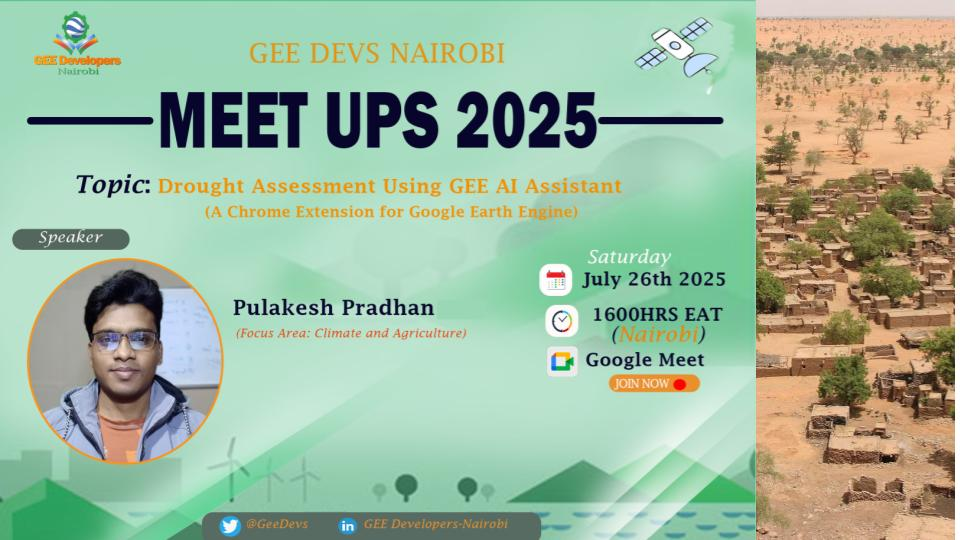

## 📰 Journal Articles

::: {.empty-note}
<i class="bi bi-hourglass-split"></i> Peer-reviewed journal articles are in progress. This section will be updated as they are published.
:::

## 📚 Book Chapters

::: {.publication-list}

::: {.publication-item}

  <a href="https://www.researchgate.net/publication/390714931_Application_of_analytic_hierarchy_process_for_mapping_flood_vulnerability_in_Odisha_using_Google_Earth_Engine" class="stretched-link">Application of analytic hierarchy process for mapping flood vulnerability in Odisha using Google Earth Engine</a>

::: {.publication-main}
::: {.publication-image}

:::

::: {.publication-body}

**Pradhan, P.**, Bajpai, R., & Patra, S. (2025)

In Google Earth Engine and Artificial Intelligence for Earth Observation, Elsevier

This research utilizes the Analytic Hierarchy Process (AHP) within the Google Earth Engine environment to map flood vulnerability in Odisha, India. By integrating various geomorphological and climatic parameters, the study produces high-resolution vulnerability maps to assist in disaster management and mitigation strategies.

  <a href="publications/Pulakesh Pradhan AHP.pdf" class="capsule-btn btn-download">
    <i class="bi bi-file-earmark-pdf"></i> Download
  </a>
  <a href="https://doi.org/10.1016/b978-0-443-27372-8.00025-8" class="capsule-btn btn-doi">
    <i class="bi bi-link-45deg"></i> DOI
  </a>

:::
:::
:::

::: {.publication-item}

  <a href="https://www.researchgate.net/publication/384435525_Agricultural_drought_monitoring_using_Google_Earth_Engine_a_study_of_Paschim_Medinipur_district_West_Bengal" class="stretched-link">Agricultural drought monitoring using Google Earth Engine: a study of Paschim Medinipur district, West Bengal</a>

::: {.publication-main}
::: {.publication-image}

:::

::: {.publication-body}

**Pradhan, P.**, & Patra, S. (2024)

In Modern Cartography Series, Elsevier

This study presents a remote sensing-based approach to monitoring agricultural drought in the Paschim Medinipur district. Using long-term satellite data and vegetation indices processed on the cloud, I analyze spatiotemporal drought patterns and their impact on local agriculture.

  <a href="publications/Agricultural_drought_GEE_Pulakesh_Pradhan_Sribas_Patra.pdf" class="capsule-btn btn-download">
    <i class="bi bi-file-earmark-pdf"></i> Download
  </a>
  <a href="https://doi.org/10.1016/b978-0-443-23890-1.00011-6" class="capsule-btn btn-doi">
    <i class="bi bi-link-45deg"></i> DOI
  </a>

:::
:::
:::

:::

## 🎤 Presentations

::: {.publication-list}

::: {.publication-item}

  <a href="https://gdg.community.dev/events/details/google-gdg-for-earth-engine-nairobi-presents-drought-monitoring-with-google-earth-engine-ai-assistant-powered-by-gemini-api/" class="stretched-link">Drought Monitoring with GEE AI Assistant powered by Gemini API</a>

::: {.publication-main}
::: {.publication-image}

:::

::: {.publication-body}

**Pradhan, P.** (2025)

GDG for Earth Engine Nairobi (Virtual)

A demonstration of integrating Large Language Models (LLMs) with geospatial platforms. This workshop showcases how a Gemini-powered AI assistant can streamline complex GEE coding tasks for drought monitoring, making cloud-based remote sensing more accessible to researchers.

  <a href="https://gdg.community.dev/events/details/google-gdg-for-earth-engine-nairobi-presents-drought-monitoring-with-google-earth-engine-ai-assistant-powered-by-gemini-api/" class="capsule-btn btn-doi">
    <i class="bi bi-calendar-event"></i> Event Page
  </a>

:::
:::
:::

:::

## 🖼️ Posters

::: {.publication-list}

::: {.publication-item}

  <a href="https://www.researchgate.net/publication/382254955_Near_Real-Time_Air_Quality_Trend_Monitoring_in_Odisha_Using_Multi-Sensor_Satellite_Images" class="stretched-link">Near Real-Time Air Quality Trend Monitoring in Odisha Using Multi-Sensor Satellite Images</a>

::: {.publication-main}
<a href="publications/ORC2023_Pulakesh_Pradhan.pdf" class="publication-image pdf-tile">
<i class="bi bi-file-earmark-pdf"></i>
View Poster (PDF)
</a>

::: {.publication-body}

**Pradhan, P.**, & Bajpai, R. (2023)

Odisha Research Conclave (ORC-2023)

This poster presentation demonstrates a multi-sensor satellite approach for monitoring air quality trends in Odisha. Using a combination of Sentinel-5P and MODIS data, the research provides a near real-time assessment of pollutants to support environmental policy and public health awareness.

  <a href="publications/ORC2023_Pulakesh_Pradhan.pdf" class="capsule-btn btn-download">
    <i class="bi bi-file-earmark-pdf"></i> Download PDF
  </a>
  <a href="https://www.researchgate.net/publication/382254955_Near_Real-Time_Air_Quality_Trend_Monitoring_in_Odisha_Using_Multi-Sensor_Satellite_Images" class="capsule-btn btn-doi">
    <i class="bi bi-link-45deg"></i> Details
  </a>

:::
:::
:::

:::

---

Full publication lists available via:

[<i class="bi bi-mortarboard"></i> Google Scholar](https://scholar.google.com/citations?user=_DhEQHEAAAAJ){.social-btn}
[<i class="bi bi-person-badge"></i> ResearchGate](https://www.researchgate.net/profile/Pulakesh-Pradhan){.social-btn}
