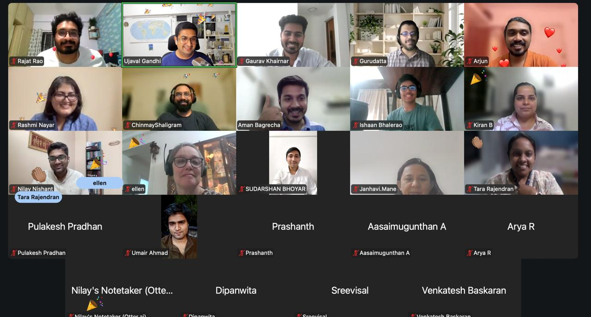
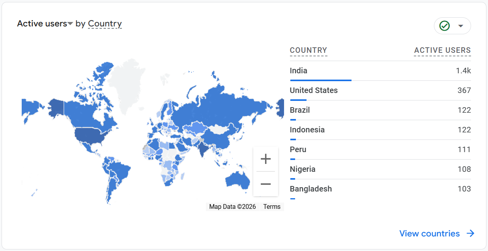
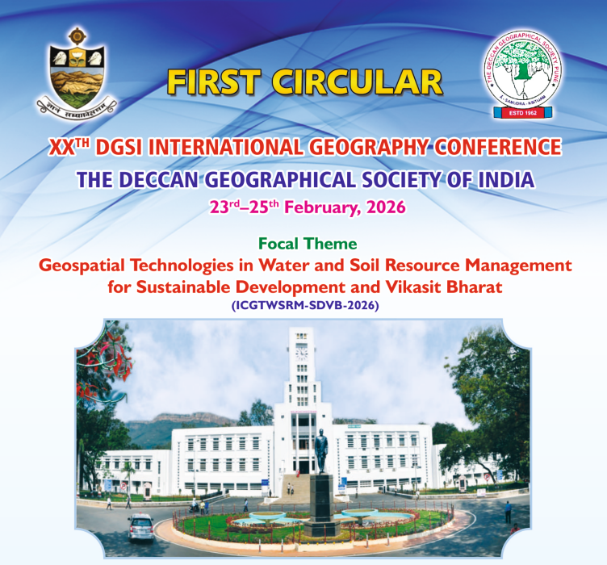
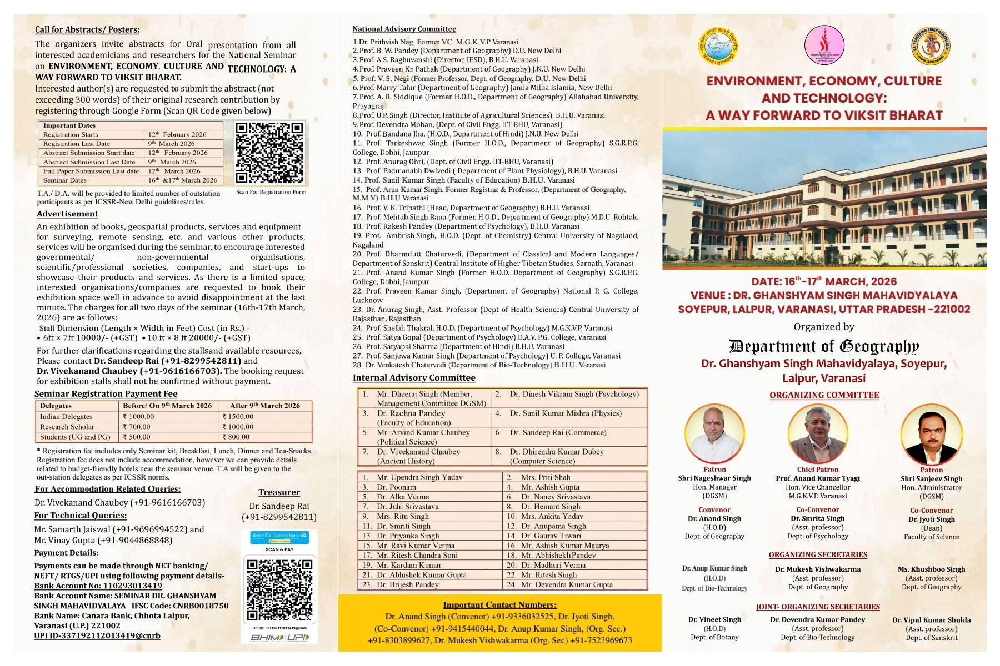

::: {.column-page}

::: {.social-card}
::: {.social-content}
### QGIS India User Group

We are a community of QGIS users passionate about open-source geospatial technology. Our mission is to promote the use of QGIS, share knowledge, and support each other in our geospatial projects.

*   Shared space for QGIS users across India.
*   Encourage knowledge sharing, mentorship, and collaboration.
*   Organize local meetups, workshops, and learning initiatives.
*   Strengthen India's contribution to the global QGIS project.

::: {.pill-row}
[Visit Website](https://in.qgis.org/){.pill-btn .pill-solid}
[Join Telegram](https://t.me/+YVUWbgjA320wZGU1){.pill-btn}
:::
:::
::: {.social-media}
[{.nolightbox}](https://in.qgis.org/)
:::
:::

::: {.social-card}
::: {.social-content}
### GEE AI Assistant: 4k+ Global Users!
**Google Earth Engine Coding Companion**

Empowering the geospatial community with AI! I am proud to share that the **GEE AI Assistant** has reached over **4,000+ worldwide users** across **134 countries**. 

My Gemini-powered assistant helps researchers and developers write Earth Engine code faster and more efficiently. Thank you to my global users for being part of this innovation journey!

::: {.pill-row}
[Install Extension](https://chromewebstore.google.com/detail/kldhacnbicjpbdiebjjflnhgcmheokkl?utm_source=item-share-cb){.pill-btn .pill-solid}
[View Details](innovations.qmd){.pill-btn}
:::
:::
::: {.social-media}
[{.nolightbox}](https://chromewebstore.google.com/detail/kldhacnbicjpbdiebjjflnhgcmheokkl?utm_source=item-share-cb)
:::
:::

### 🗓️ Conference & Seminar Calendar

| Event Name | Location | Dates | Deadline | Action |
| :--- | :--- | :--- | :--- | :--- |
| **IIG International Seminar** | Siliguri, WB | Feb 19–21, 2026 | Dec 31, 2025 | [Circular](social/IIG_2026.pdf) |
| **XXth DGSI Int. Conference** | Tirupati, AP | Feb 23–25, 2026 | Feb 10, 2026 | [Circular](social/30-12-2026%20First%20Circular%20-%202026.pdf) |
| **National Seminar (Viksit Bharat)** | Varanasi, UP | March 16–17, 2026 | March 9, 2026 | [Register](https://docs.google.com/forms/d/e/1FAIpQLSdbFHgO6_CJt_1_UqFPYT2zk116Q2E_MnRm8yFwapiRkx5EZA/viewform) |
| **IASP 2026 Regional Conference** | Goa University | March 20–21, 2026 | Feb 15, 2026 | [Submit](https://forms.gle/dxgmZAGrdk5HdWVw5) |
| **XXII INQUA Congress 2027** | Lucknow, India | Jan 28 – Feb 3, 2027 | March 31, 2026 | [Register](https://register.inquaindia2027.in/) |

::: {.social-card .tint-violet}
::: {.social-content}
### IIG International Seminar
**“Geography in the 21st Century: Navigating Trends, Tackling Challenges”**

::: {.event-meta}
**📍 Location:** University of North Bengal, Siliguri  
**📅 Date:** February 19–21, 2026
:::

Organized by the Department of Geography & Applied Geography. An international platform for discussing emerging trends and tackling spatial challenges in the 21st century.

**📅 Key Dates:**

*   **Registration Fee Deadline:** 31st December, 2025

::: {.pill-row}
[Download Revised Circular (PDF)](social/IIG_2026.pdf){.pill-btn}
:::
:::
::: {.social-media}
<a href="social/IIG_2026.pdf" class="pdf-tile"><i class="bi bi-file-earmark-pdf"></i>View Circular (PDF)</a>
:::
:::

::: {.social-card .tint-sky}
::: {.social-content}
### XXth DGSI International Geography Conference
**“Geospatial Technologies in Water and Soil Resource Management for Sustainable Development and Vikasit Bharat”**

::: {.event-meta}
**📍 Location:** Sri Venkateswara University, Tirupati  
**📅 Date:** February 23–25, 2026
:::

Organized by The Deccan Geographical Society of India (DGSI). This landmark conference explores the intersection of spatial science, resource management, and national development.

::: {.pill-row}
[Download Circular (PDF)](social/30-12-2026%20First%20Circular%20-%202026.pdf){.pill-btn}
:::
:::
::: {.social-media}
[{.nolightbox}](social/30-12-2026%20First%20Circular%20-%202026.pdf)
:::
:::

::: {.social-card .tint-blue}
::: {.social-content}
### XXII INQUA Congress 2027 India
**“Quaternary Science As Societal Services”**

::: {.event-meta}
**📍 Location:** Lucknow, India  
**📅 Date:** January 28 - February 3, 2027
:::

The biggest conference in Quaternary Sciences, featuring **188 Scientific Sessions**, **21 Workshops**, and **46 Field Trips**. Funding available for participants.

**📢 Important Update:**

*   **Abstract Submission EXTENDED:** 31st March, 2026

::: {.pill-row}
[Register Now](https://register.inquaindia2027.in/){.pill-btn}
[First Circular (PDF)](https://framerusercontent.com/assets/uuOMCk51ous9qnKWe3ZLZbrTglI.pdf){.pill-btn}
:::
:::
::: {.social-media}
[{.nolightbox}](https://www.inquaindia2027.in/)
:::
:::

::: {.social-card .tint-cream}
::: {.social-content}
### Western Regional Conference: IASP 2026
**“Demographic Transition in Western India”**

::: {.event-meta}
**📍 Location:** Goa Business School, Goa University  
**📅 Date:** March 20-21, 2026
:::

A premier conference focusing on the demographic shifts and socio-economic transitions in Western India.

**📅 Last Date for Online Abstract Submission:** 15th February, 2026

::: {.pill-row}
[Submit Abstract](https://forms.gle/dxgmZAGrdk5HdWVw5){.pill-btn}
[Download PDF](social/population_iasp_2026.pdf){.pill-btn}
:::
:::
::: {.social-media}
[{.nolightbox}](social/population_iasp_2026.pdf)
:::
:::

::: {.social-card .tint-yellow}
::: {.social-content}
### National Seminar: Environment, Economy, Culture and Technology
**“A Way Forward to Viksit Bharat”**

::: {.event-meta}
**📍 Location:** Dr. Ghanshyam Singh Mahavidyalaya, Varanasi  
**📅 Date:** March 16-17, 2026
:::

Organized by the Department of Geography. This seminar invites abstracts for oral presentations on the intersection of environment, economy, and technology.

**📅 Key Dates:**

*   **Abstract Submission Deadline:** 9th March, 2026
*   **Full Paper Submission:** 12th March, 2026

::: {.pill-row}
[Register Now](https://docs.google.com/forms/d/e/1FAIpQLSdbFHgO6_CJt_1_UqFPYT2zk116Q2E_MnRm8yFwapiRkx5EZA/viewform){.pill-btn}
:::
:::
::: {.social-media}
[{.nolightbox}](social/viksit_bharat_seminar.jpg)
:::
:::

:::
